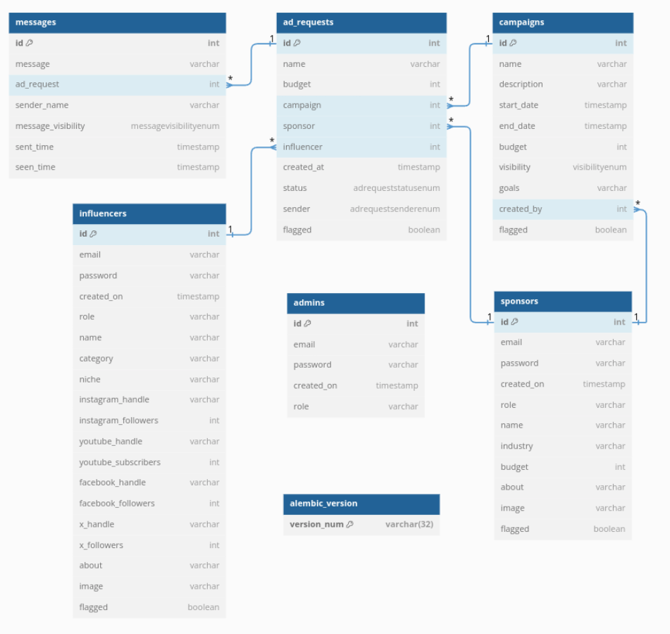
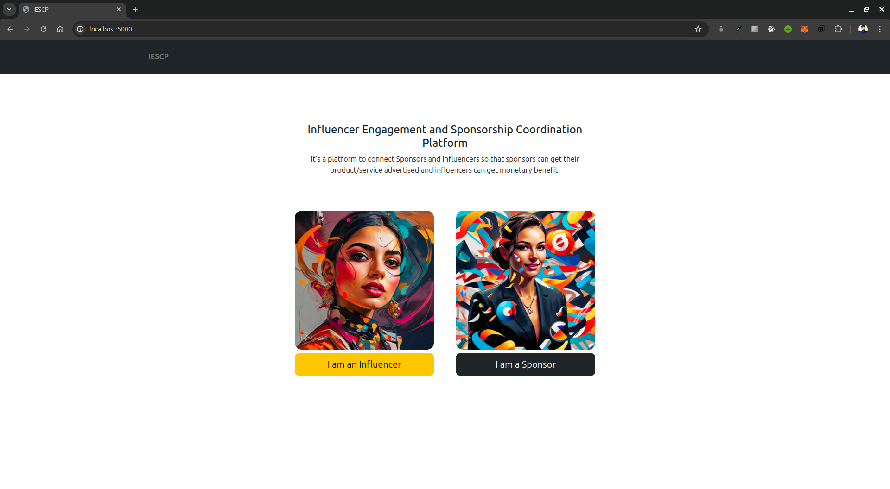
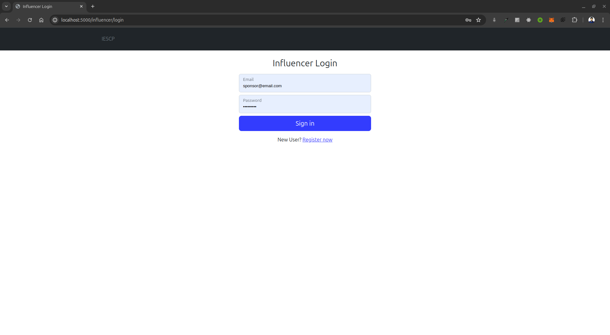
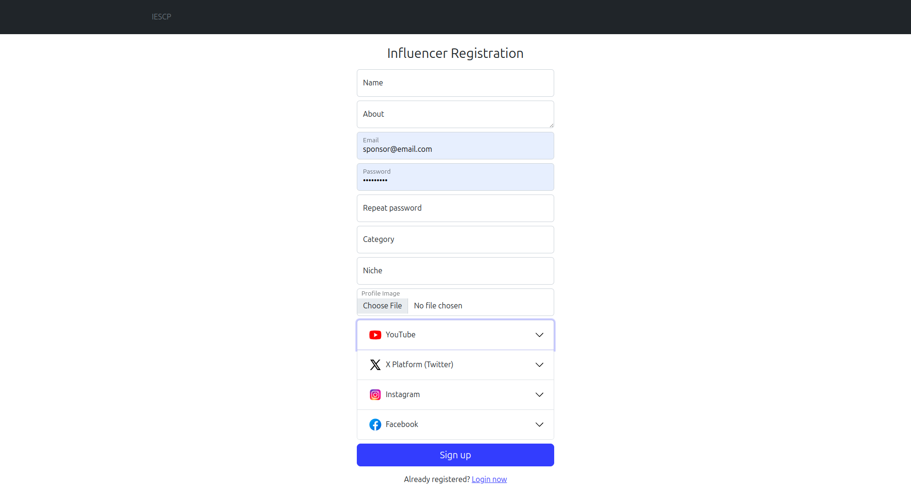
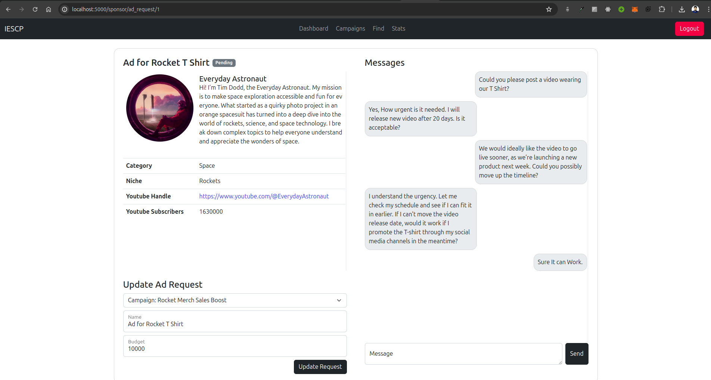
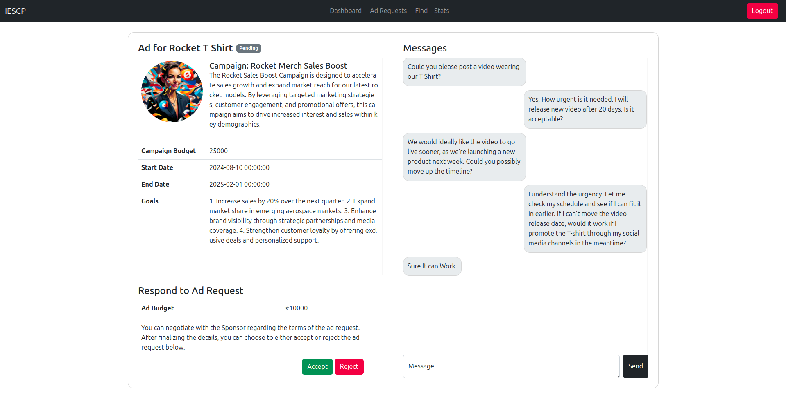
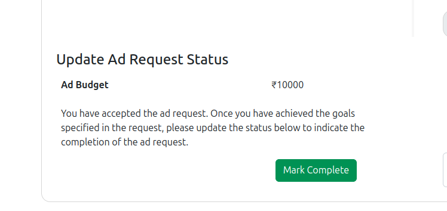
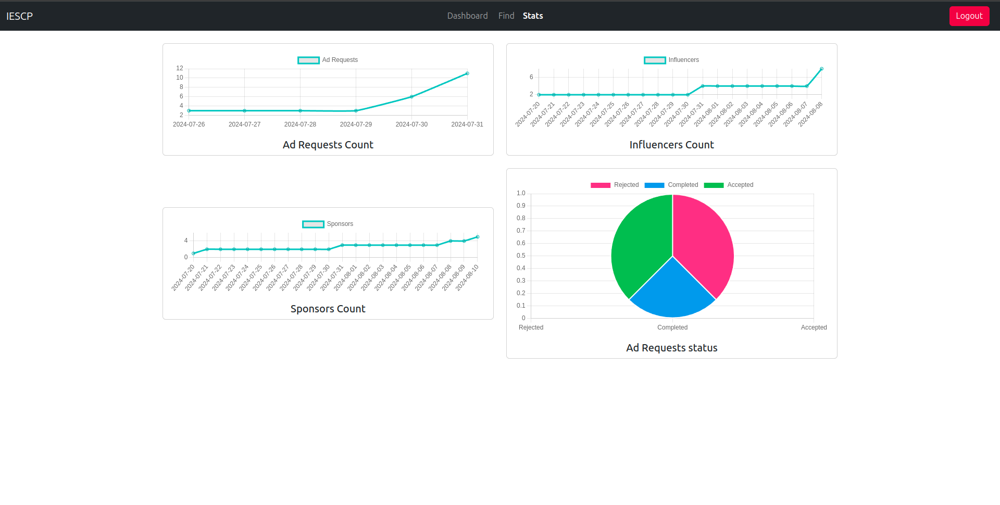
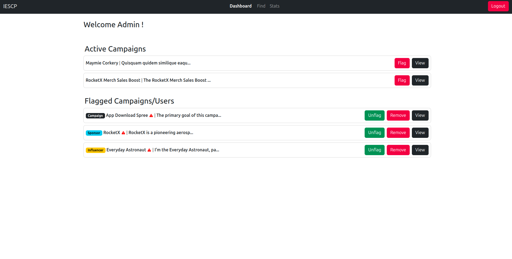
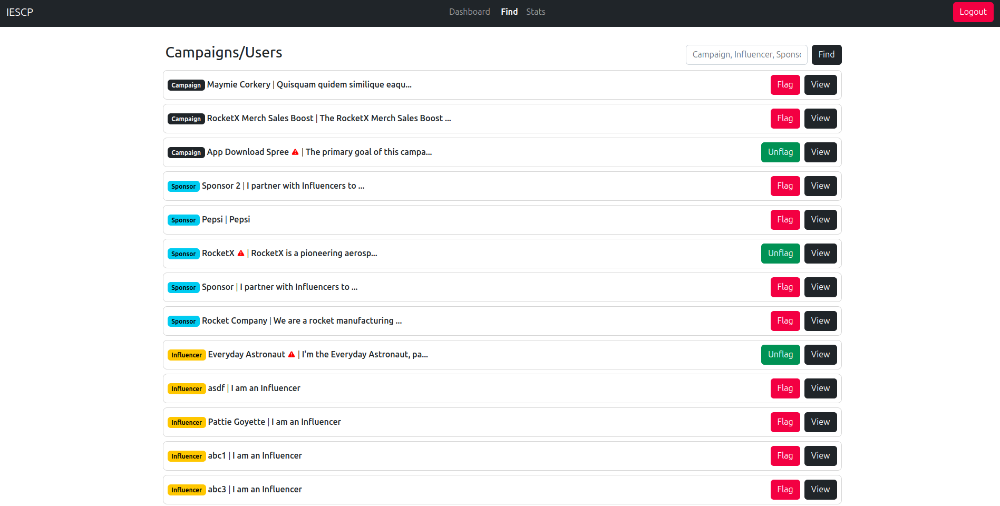

# Influencer Engagement and Sponsorship Coordinating Platform (Under Development)

## Description
It's a platform to connect Sponsors and Influencers so that sponsors can get their product/service advertised and influencers can get monetary benefit.

## Frameworks used
- Flask for application code
- Jinja2 templates + Bootstrap for HTML generation and styling
- SQLite for data storage

## How to run the application

1. Clone the repository
2. Create a virtual environment
3. Install the dependencies 
```bash
pip install -r requirements.txt
```

4. Export .env variables
```bash
source .env
```

5. Init the database (For first time only)
```bash
flask init-db
```

6. Run the migration (For first time only)
```bash
flask db migrate
flask db upgrade
```

7. Run the application
```bash
python manage.py run
```

8. Create admin user
```bash
python manage.py create_admin
```

9. Open the browser and go to `http://localhost:5000`

## Test Credentials
influencer@email.com
123456789

rocket-company@email.com
123456789

admin@email.com
123456789

## Screenshots


ER Diagram


Home page


Influencer Login


Influencer Registration


Ad Request creator can update ad request.


Ad Request Receiver can accept or reject an ad request.


Requst can be marked complete after work is done .


Stats page


Admin Dashboard


Admin Find Page

